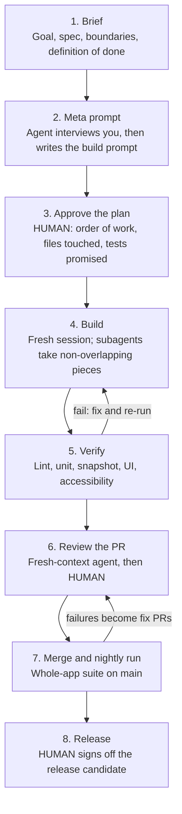

# The pipeline: Figma to release

Eight steps take a feature from brief to release, with a person approving at three points: the plan, the PR and the release.

| Step | Who |
| --- | --- |
| 1. Brief | Engineer with product owner |
| 2. Meta prompt | Planner agent |
| 3. Approve the plan | Engineer |
| 4. Build | Builder agent and subagents |
| 5. Verify | CI and verifier agent |
| 6. Review the PR | Reviewer agent, then engineer |
| 7. Merge and nightly run | CI and triage agent |
| 8. Release | Release owner |

A failed check loops from Verify back to Build without a person involved. Nightly failures re-enter at step 6 as fix PRs, so they get the same review as feature work.

## The Figma step

The planner reads the Figma frames through the Figma MCP server. How well that works depends on Code Connect, which maps Figma components to the real components in your codebase.

Figma's own tests found that with design system components mapped, agents finished design-to-code tasks about 20% faster, used about 30% fewer tokens, and scored one point higher on a four-point quality scale ([Figma](https://figma.com/blog/the-benefits-of-code-connect-in-mcp)). Coverage drove most of the gain. Those tests used React design systems, so treat the numbers as directional for SwiftUI and Compose.

Code Connect has integrations for SwiftUI and Jetpack Compose ([Figma developer docs](https://developers.figma.com/docs/code-connect)).

Figma is sometimes imperfect. The design system is the source of truth, and differences get flagged in the PR, not copied.
